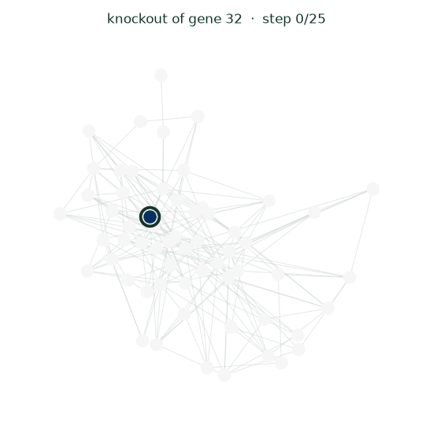
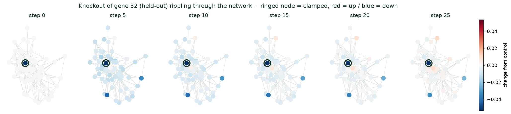
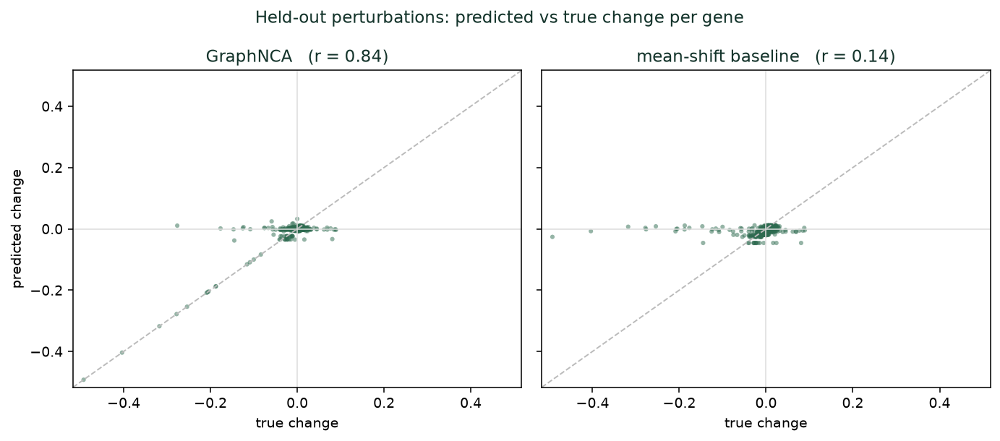
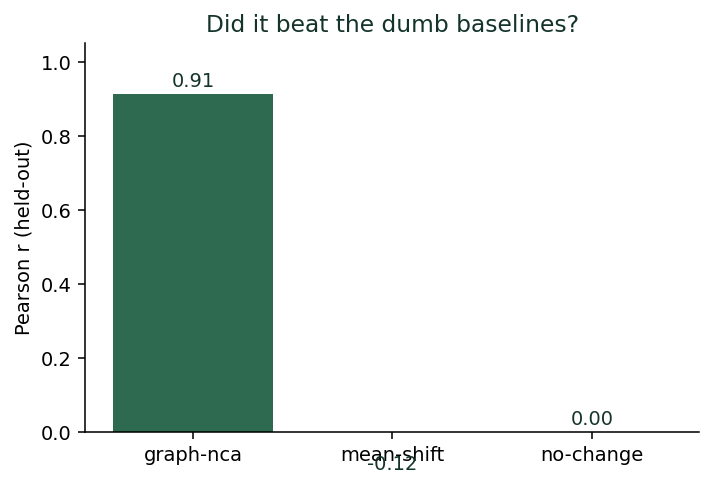
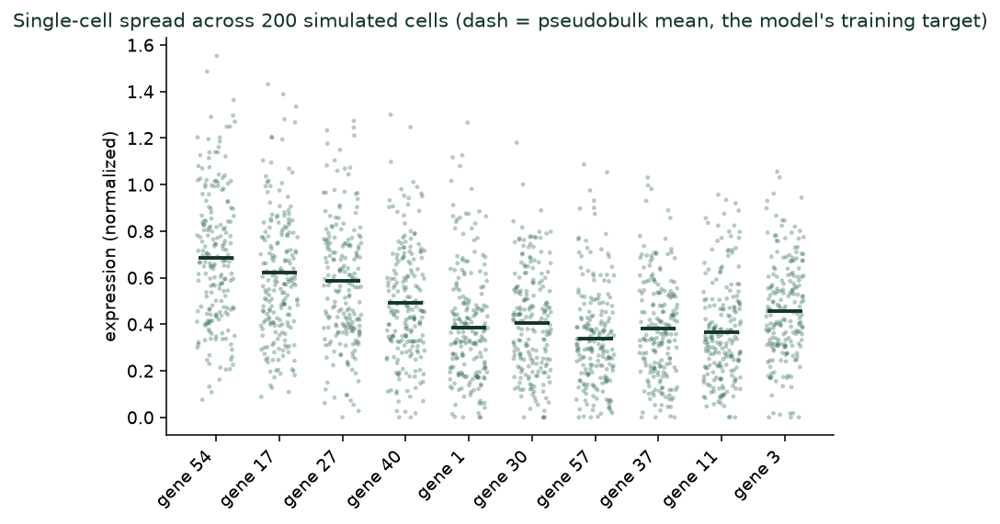

# gene-nca

**A cell modelled as a neural cellular automaton over its gene-regulatory network — used to predict how the cell responds to genetic perturbations.**



*A held-out gene knockout — never shown to the model during training — rippling through the network and settling. Ringed node = clamped, red = up-regulated, blue = down-regulated.*

Most models that predict perturbation responses treat the cell as a black box. This one borrows the idea behind *Growing Neural Cellular Automata* (Mordvintsev et al., 2020): a single shared local rule, applied to every unit over and over, until the system settles — the same process that lets those models grow a pattern and *heal it back* after damage. Here the "grid" is replaced by the gene-regulatory graph, and "healing back to a stable state after a disturbance" is exactly what a cell does after you knock out a gene.

To predict a knockout, we pin the perturbed gene's expression to its silenced value and let the automaton relax. The settled state is the prediction.

> This repo is the **sandbox-first** stage: a synthetic gene network where we control the wiring, so we know the true answer for every perturbation and can prove the core idea works before touching messy real data.
>
> The ground truth now comes from a **SERGIO-style simulator** (`src/sergio_sim.py`): Hill-function regulatory kinetics simulated per-cell via the Chemical Langevin Equation, so a "knockout" is a population of independently-noisy cells settling around a clamp, not one deterministic number. See [How it works](#how-it-works) for why it's a reimplementation rather than the original package.

## The result

Trained on knockouts of one set of genes, the model predicts knockouts of genes it **never saw perturbed**, purely by propagating a novel clamp through the learned network dynamics. It is compared against two deliberately dumb baselines — because a model that only ties a dumb baseline is not a finding.

| method | Pearson r (held-out) | sign accuracy on true DEGs | MSE |
|---|---|---|---|
| **GraphNCA** | **0.770** | **0.649** | **0.00041** |
| mean-shift baseline | 0.207 | 0.542 | 0.00136 |
| no-change baseline | 0.000 | 0.000 | 0.00139 |

Stable across seeds (r ≈ 0.70–0.77, sign accuracy ≈ 0.64–0.90; baselines stay well below). `no-change` predicts the control for everything; `mean-shift` predicts the *average* training response for every test perturbation — it captures the typical ripple but cannot specialise to the specific gene knocked out, which is the whole game.

These numbers are lower than the old toy-ODE sandbox's (r ≈ 0.91, sign acc ≈ 0.76) — expected and intended. Swapping in the SERGIO-style simulator (below) made the sandbox honestly harder: single-cell noise, Hill-saturating kinetics instead of one global sigmoid, and knockouts whose downstream effect is now genuinely diluted across each target's other active regulators. The model still separates cleanly from both baselines; it just no longer gets a suspiciously easy ride.

### The perturbation rippling through the network and settling


*A held-out knockout (ringed node) spreading hop-by-hop through the gene graph. Red = up-regulated, blue = down-regulated, relative to the unperturbed control. This is a genuine readout of the predicted mechanism, not a cartoon.*

### Held-out generalization


### Beating the baselines


### Single-cell spread the model is trained against


*Every "control" and "knockout" is now a population of independently-simulated cells (Chemical Langevin Equation noise on top of shared Hill kinetics), pseudobulked to the value the model actually predicts (dash). The toy ODE this replaced had no notion of a cell at all — one deterministic number per gene, no spread.*

## Run it

```bash
pip install -r requirements.txt
python run.py
```

Runs in ~1–2 minutes on CPU. Figures land in `figures/`. Flags: `--genes`, `--seed`, `--steps`, `--epochs`, `--simulator {sergio,toy}` (default `sergio`), `--cells` (cells per condition, sergio only, default 200).

## How it works

```
src/
  grn.py         toy deterministic simulator: one sigmoid-of-linear ODE settles
                 to a single steady state per gene. Kept as a fast, noise-free
                 debugging rig (`--simulator toy`).
  sergio_sim.py  SERGIO-style simulator (default): Hill-function regulatory
                 kinetics + Chemical Langevin Equation, integrated per CELL, so
                 a "steady state" is a noisy population pseudobulked to one
                 target vector. See its docstring for why this is a from-scratch
                 reimplementation of github.com/PayamDiba/SERGIO's published
                 model rather than the original package.
  data.py        builds the supervised dataset (either simulator) and the
                 train/test split over PERTURBED GENES (held-out generalization
                 test) — downstream code doesn't care which simulator built it
  model.py       GraphNCA: message passing over the gene graph + a shared residual
                 update rule, iterated to a fixed point, with the perturbed gene
                 clamped every step
  train.py       backprop-through-time over the unrolled settling steps, with a
                 weighted MSE that emphasises genes that actually move
  evaluate.py    held-out metrics vs the dumb baselines
  visualize.py   the ripple animation frames + generalization + baseline +
                 single-cell-spread figures
run.py           generate -> train -> evaluate -> figures
```

The model is given **only the binary graph structure** (which genes regulate which). It is *not* given the true edge signs, weights, basal drives, or the generator's equations — it has to learn the rule from the training perturbations alone. That's true of both simulators.

### Why a reimplementation and not the real SERGIO

[SERGIO](https://github.com/PayamDiba/SERGIO) (Dibaeinia & Sinha, 2020, *Cell Systems*) is distributed only via GitHub, not PyPI, and this project's execution environment doesn't allow fetching arbitrary GitHub repos. Rather than skip the upgrade, `src/sergio_sim.py` re-derives SERGIO's model directly from the paper: master regulators with a fixed basal production rate, target genes whose production is a sum of Hill-function contributions from their regulators (increasing for an activator, decreasing for a repressor), and the whole population integrated cell-by-cell via the Chemical Langevin Equation, plus an optional dropout/library-size technical-noise layer for diagnostics. A knockout clamps the perturbed gene's concentration every step of that integration — the same clamp-and-resettle idea as the toy simulator, just now on genuinely stochastic single-cell dynamics instead of one deterministic ODE.

## Honest caveats

- **This is a proof-of-concept, not proof it beats real methods.** The synthetic generator and the model share an inductive bias (both settle to an attractor on a graph), so strong sandbox performance shows the model *can* learn and generalise perturbation dynamics — it does **not** show it wins on real data. That's the next stage, and the point of keeping the sandbox as a permanent debugging rig.
- **Graph quality matters.** Here the structure is perfect. On real data the regulatory graph is noisy and partial; robustness to bad edges is itself an experiment worth running.
- **One settled state ≈ pseudobulk.** The model still predicts a single resting state (the pseudobulk mean over simulated cells), which maps cleanly onto pseudobulk-level metrics (the ones that mattered most in the 2025 Virtual Cell Challenge). The simulator now generates real cell-to-cell variability (see the single-cell figure above) — the model just doesn't consume or predict it yet.
- **Not the real SERGIO codebase.** `sergio_sim.py` reimplements the published algorithm, not `PayamDiba/SERGIO` itself — see above. It hasn't been cross-checked numerically against the reference implementation.

## Roadmap

1. ~~Swap the toy simulator for SERGIO~~ — done: `src/sergio_sim.py` (a from-scratch reimplementation; see above for why).
2. **Real Perturb-seq slice** — reproduce a known baseline (e.g. Arc Institute's open **STATE** model) before claiming anything, and score with **Cell-Eval / PerturBench** so numbers are comparable to the field.
3. **Virtual Cell Challenge** — plug into the held-out-cell-type task; the natural contribution is a rigorous "where does this lens win and where does it lose" analysis, plus the interpretable ripple as a mechanism readout.
4. **Learn the graph** — currently the structure is given; relax that and let edges be inferred or refined.
5. **Consume single-cell variability** — the sergio simulator now produces a full population per condition (`ds["control_cells"]`); the model still only sees the pseudobulk mean. Predicting the distribution (or at least its spread) is the natural next step now that the data supports it.

## Reference

- Mordvintsev, Randazzo, Niklasson, Levin (2020). *Growing Neural Cellular Automata.* Distill.
- Dibaeinia, Sinha (2020). *SERGIO: A Single-Cell Expression Simulator Guided by Gene Regulatory Networks.* Cell Systems.
- Arc Institute — Virtual Cell Challenge (task, data, metrics, STATE baseline).

MIT licensed.
